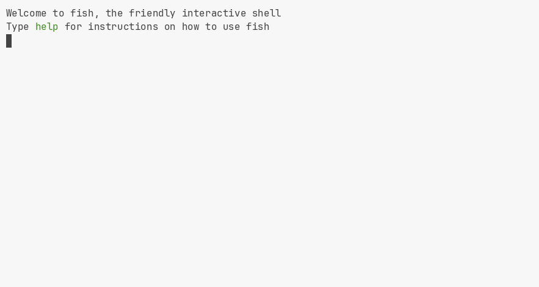

# transw — translate wrapper with response caching

## transw uses

- [Translate Shell](https://archlinux.org/packages/extra/any/translate-shell/)
- OCaml (code)
- Sqlite3 (caching)

## Supported languages

- From English to Russian (en:ru)
- From Russian to English (ru:en)

## Supported architectures

- Arch Linux
